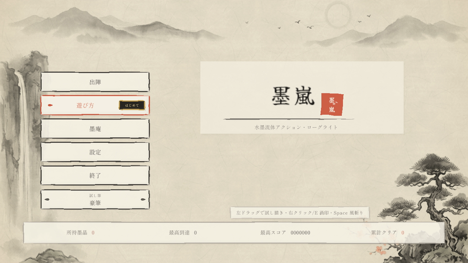
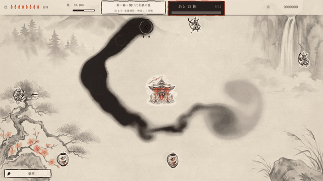
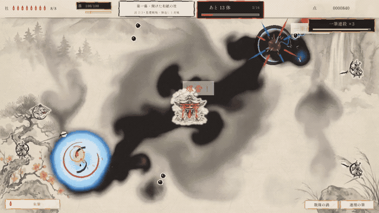
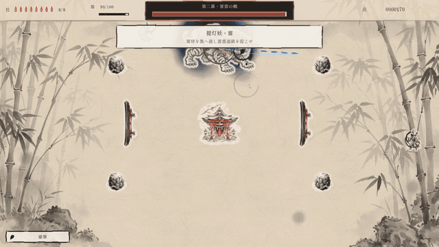
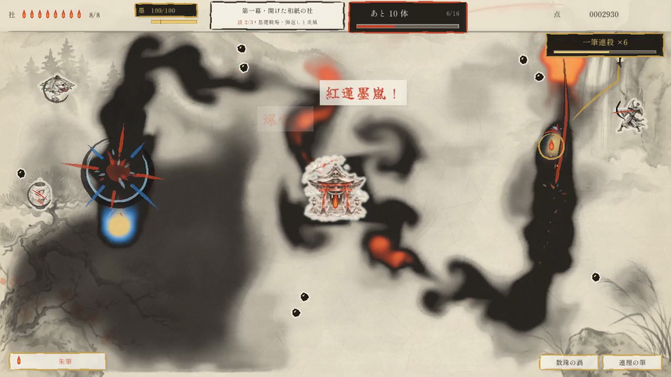
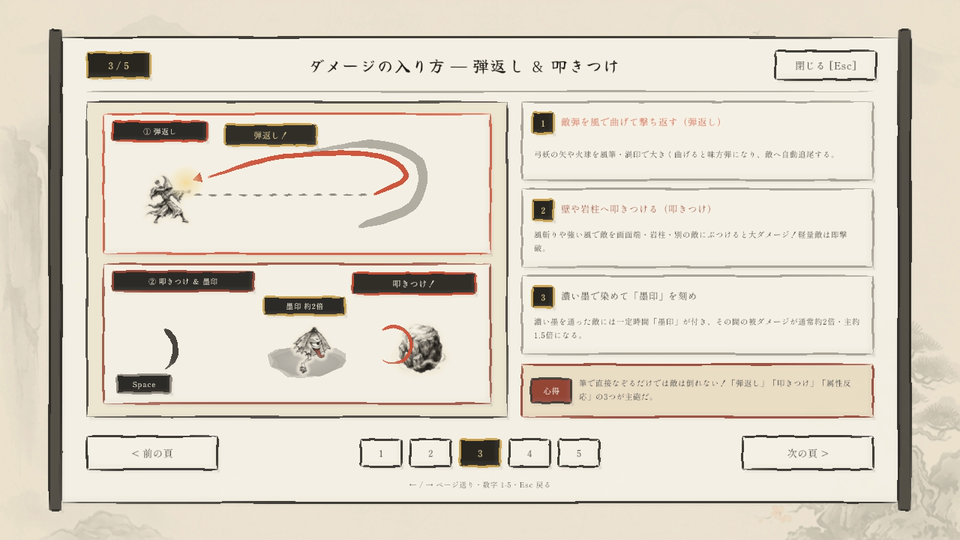
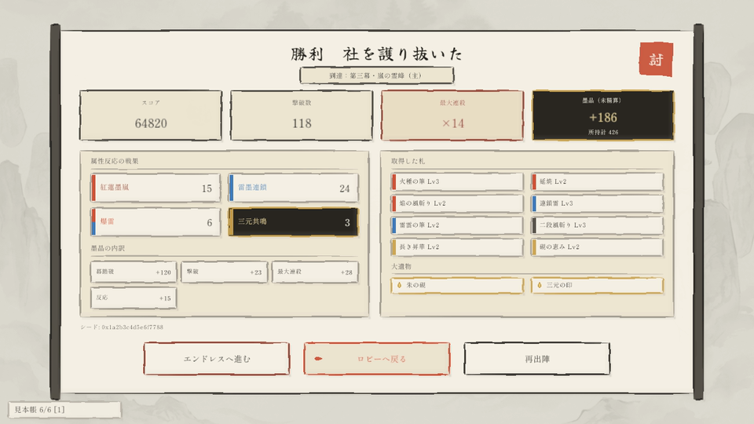

# INKSTORM（墨嵐）

**筆で風と墨を描き、妖怪の軍勢から社を護る 2D 水墨流体アクション・ローグライト**

> ※ 大学の授業課題として制作したプロジェクトです。



---

## どんなゲーム？

**INKSTORM（墨嵐）** は、リアルタイムの 2D 流体シミュレーション上で「筆致そのもの」を武器にして戦う、水墨画テイストのアクション・ローグライトです。

プレイヤーは直接キャラクターを動かすのではなく、マウスによる**筆さばき**で戦場に**風と墨の流れ**を生み出します。
敵の矢や火球を風で大きく曲げて撃ち返す「**弾返し**」、突風で妖怪を岩柱や画面端へ叩きつける「**叩きつけ**」、そして墨・炎・雷が交わって連鎖する「**属性反応**」を組み合わせ、中央の**社**（やしろ）を護り抜きます。

1 プレイは全 3 幕＋エンドレス構成。幕ごとに強化札や大遺物を組み合わせてビルドを育て、得た**墨晶**で拠点「墨庵」の恒久強化や新たな大遺物を解放しながら、より深い墨嵐へと挑みます。

---

## プレイ映像

### 風筆・渦印・風斬りによる流体アクション

筆で描いた風がリアルタイムに流れ、敵弾の偏向・弾返しや、渦による引き寄せ、突風での叩きつけが連鎖します。



### 墨・炎・雷が交わる属性連鎖

墨だまりに炎や雷の気配を巻き込むことで、**紅蓮墨嵐**・**雷墨連鎖**・**爆雷**といった大反応が次々と爆発します。



### 各幕の主（ボス）との決戦

第 1 幕「大天狗」、第 2 幕「鵺（ぬえ）」、第 3 幕「一筆龍」が立ちはだかります。下の映像は第 2 幕の主・雷雲の鵺との戦闘シーンです。



---

## 主な特徴

- **3 つの筆技（風筆・渦印・風斬り）**
  - **風筆**（左ドラッグ）で風と墨を描き、濃い墨を通った敵に被ダメージが増える「墨印」を刻みます。
  - **渦印**（右クリック / `E`）で敵弾・墨・墨玉を 1 点へ巻き込み、**風斬り**（`Space`）の突風で敵を壁や岩柱へ叩きつけます。
- **4 大属性反応**
  - **紅蓮墨嵐（墨＋炎）**: 墨と炎が燃え広がり、通過する弾を炎上弾へ変化させます。
  - **雷墨連鎖（墨＋雷）**: 墨の上を走る雷撃が周囲の敵へ次々と連鎖します。
  - **爆雷（炎＋雷）**: 炎と雷が交わり、重い敵をも吹き飛ばす爆風を起こします。
  - **三元共鳴（墨＋炎＋雷）**: 3 属性が重なることで発動する、大爆風と広域雷撃の最大反応です。
- **3 種の筆スタイル**
  - **豪筆**: 太く強い筆致で、弾返しと叩きつけに優れたバランス型。
  - **朱筆**: 筆跡と風斬りに火種を宿す、炎反応特化の高火力型。
  - **細筆**: 軽く速い筆致に加え、帯電した渦印と高い吸引力で手数を稼ぐ技巧型。
- **奥深いローグライト＆拠点「墨庵」**
  - **強化札 28 種**と**大遺物 15 種**で、風・墨・炎・雷のシナジーを自在に構築。
  - 出陣で持ち帰った**墨晶**を使い、**墨庵**で恒久強化 4 種と追加の大遺物 6 枠を解放できます。
- **全 3 幕のボス戦＋エンドレスモード**
  - 第 1 幕「紅風の大天狗」、第 2 幕「雷雲の鵺」、そして味方に結界を張り追尾符を放つ「狐符」や、炎・雷・風の 3 つの龍玉を宿す多部位ボス「**一筆龍**」が登場する第 3 幕を収録。
  - 第 3 幕クリア後はそのまま**エンドレスモード**（第 4 幕以降）へ挑めます。
- **図解「遊び方」ガイド＆ロビー試し描き**
  - ロビーからいつでも開ける **5 枚スライドの図解「遊び方」** を搭載。
  - ロビーの和紙余白では、3 種の筆を切り替えて本番と同じ流体エンジンで試し描きができます。

---

## スクリーンショット

| 戦闘画面（紅蓮墨嵐と属性連鎖） | 図解「遊び方」ガイド（全 5 枚） | リザルト画面（戦果・取得札・エンドレス） |
| :---: | :---: | :---: |
|  |  |  |

---

## 操作方法

| 画面 | 操作 | 内容 |
| --- | --- | --- |
| **タイトル / ロビー** | `↑` `↓` / `Enter` / `1`〜`5` / クリック | 「出陣」「遊び方」「墨庵」「設定」「終了」を選択 |
| | 左ドラッグ（和紙余白から開始） | 戦闘と同じ筆で和紙キャンバスに試し描き |
| | 右クリック / `E` / `Space` | 試し描き中の渦印 / 風斬り |
| | `←` `→` / 試し筆パネルのクリック | 試し描きに使う筆（豪筆・朱筆・細筆）を切替 |
| | `Esc` / 閉じるボタン | アプリケーションを終了 |
| **遊び方（図解 5 枚）** | `←` `→` / `A` `D` / `Space` / クリック | 前後のページへ移動（`Enter` は次へ進み、最終頁で閉じる） |
| | `1`〜`5` / ページ番号クリック | 指定ページへ直接移動 |
| | `Esc` / 閉じるボタン | ロビーへ戻る |
| **筆スタイル選択** | `←` `→` / `Enter` / `1`〜`3` / クリック | 豪筆・朱筆・細筆を選んで出陣 |
| | `Esc` / 戻るボタン | ロビーへ戻る |
| **墨庵（メタショップ）** | 矢印キー / `Enter` / クリック | 墨晶で恒久強化 4 種・大遺物解放 6 枠を購入（左右で列移動） |
| | `Esc` / 戻るボタン | ロビーへ戻る |
| **設定画面**<br>*(ロビー / ポーズから開閉)* | `↑` `↓` | 項目選択（マスター/BGM/SE 音量、ポストシェーダ、画面揺れ、操作ヒント、表示言語、閃光軽減、カーソル倍率、初回ヒント初期化、設定を既定に戻す） |
| | `←` `→` / `Enter` / クリック | 値を変更（即時反映・保存）または初期化を実行 |
| | `Esc` / 戻るボタン | 設定を保存して元の画面へ戻る |
| **戦闘中** | 左ドラッグ | **風筆**（風と墨を描き、敵弾を偏向・撃ち返す） |
| | 右クリック / `E` | **渦印**（渦を起こし、敵弾・墨・墨玉を集める） |
| | `Space` | **風斬り**（直線の突風で敵を叩きつける。「二段風斬り」Lv3 で 2 チャージ蓄積可） |
| | `Esc` | ポーズメニューの開閉 |
| **ポーズメニュー** | `↑` `↓` / `Enter` / `1`〜`4` / クリック | 「再開」「最初から」「設定」「ロビーへ戻る」を選択 |
| | `Esc` | 再開（確認ダイアログ中はキャンセル） |
| **報酬画面** | `1`〜`3` / クリック | 強化札または大遺物を選択 |
| | `R` / クリック | 候補を引き直す（リロール） |
| | `4` / クリック | 社を修繕する（強化札時） |
| | `1` または `4` / `2` / クリック | 候補枯渇時は「社を修繕（超過分は墨晶変換）」または「墨晶を得る」の 2 択から選択（墨晶枠がない場合は `1` または `4` で修繕） |
| **リザルト画面** | `←` `→` / `Enter` / クリック | 「エンドレスへ進む」（第 3 幕クリア時のみ）／「ロビーへ戻る」（`Esc` 可）／「再出陣」を選択 |
| **その他** | `F1` | X 線オーバーレイ（流速ベクトル・渦度・固体境界枠・属性セル数・描画/流体計測）の切替 |
| | ウィンドウの閉じるボタン | 終了（ラン中なら敗北として精算・保存して終了） |

> ※ ポーズメニューの「最初から」「ロビーへ戻る」は、確認ダイアログの後に現在の出陣を敗北として精算・保存します（第 1 幕開始直後の幕転換中を除く）。
> ※ 第 3 幕クリア時の「エンドレスへ進む」を選ぶと、未精算のまま大遺物報酬を受け取って第 4 幕以降へ周回継続し、終了時に一括精算されます。

---

## ビルド & 起動方法

### 1. スタンドアロンビルド（配布ソース zip 向け）

Linux 上で配布アーカイブを展開し、`Makefile` のあるディレクトリで実行します。
GNU Make、GCC、**raylib 6.2** のヘッダと静的ライブラリ、OpenGL / X11 の開発用ライブラリが必要です。

```sh
make
make run
```

raylib の既定の配置先は `$HOME/.local/opt/raylib-6.2` です。別の配置先を使う場合は `include/raylib.h` と `lib/libraylib.a` を含むディレクトリを `RAYLIB_DIR` で指定してください。

```sh
make RAYLIB_DIR=/path/to/raylib-6.2
./inkstorm --headless-smoke
```

ビルド成果物は `make clean` で削除できます。

### 2. 開発用ビルド（CMake / Nix）

リポジトリ直下では CMake プリセット（および `nix develop`）を利用できます。

```sh
# Release ビルドと起動
nix develop -c cmake --preset release
nix develop -c cmake --build --preset release
nix develop -c ./build/release/inkstorm

# ASan / UBSan ビルドとテスト
nix develop -c cmake --preset asan
nix develop -c cmake --build --preset asan
nix develop -c ctest --preset asan --output-on-failure
```

Nix を使わない環境でも、CMake・Ninja・GCC・raylib 6.2 が揃っていれば `nix develop -c` なしで同じプリセットを実行できます。

### 主な CLI オプション

| オプション | 説明 |
| --- | --- |
| `--no-post` | 和紙ポストシェーダと GPU 水墨流体シェーダを無効にして直接描画する |
| `--no-save` | セーブファイルを読み書きせずに起動する |
| `--save-path PATH` | セーブファイルの保存先を明示指定する |
| `--demo` | 固定シードの自動プレイデモを起動する（`F1` 切替・`Esc` 終了） |
| `--snap DIR` | 指定ディレクトリへ要所 PNG 6 枚（`snap_01.png`〜`snap_06.png`）をオフスクリーン描画で自動保存して終了する（`--showcase --snap DIR` で見本帳 6 枚） |
| `--showcase` | 全登場物・反応・UI 部品を確認する見本帳シーンを起動する |
| `--smoke-frames N` | 隠しウィンドウで `N` フレーム描画して終了する（`N` は正の整数） |
| `--headless-smoke` | ウィンドウを開かずに動作確認を行う |

### セーブ先

以下の優先順で保存先を決定します（`--no-save` / `--headless-smoke` / `--smoke-frames` / `--showcase` / `--demo` / `--snap` 指定時は読み書きしません）。

1. `--save-path PATH` で指定したパス
2. `$XDG_DATA_HOME/inkstorm/save.txt`（絶対パスの場合）
3. `$HOME/.local/share/inkstorm/save.txt`
4. 実行ファイルと同じディレクトリの `inkstorm_save.txt`

---

## 技術構成

- **言語・基盤**: C11（`-std=c11 -Wall -Wextra -Wpedantic -Wshadow`）＋ raylib 6.2。`core` / `fluid` / `ecs` / `game` / `audio` / `render` / `app` にモジュール分離し、描画非依存のヘッドレス検証に対応。
- **2D 流体ソルバ**: 160×90 正方格子のリアルタイム Eulerian 流体ソルバ（セミラグランジュ移流・渦度閉じ込め・Red-Black ガウス＝ザイデル圧力投影・固体境界対応、墨/炎/雷の多チャンネル移流）。
- **決定論 ECS**: 世代管理つきハンドルを備えた固定 60 Hz ステップの ECS と SplitMix64 乱数により、同一シード・同一入力から完全再現可能なシミュレーションを実現。
- **水墨＆和紙シェーダ**: GLSL 和紙ポストシェーダ・GPU 水墨流体シェーダ・水墨スプライトアトラスを組み合わせ、シェーダやアセット欠損時は組み込み描画へ自動フォールバック。
- **ハイブリッド音声**: 外部 OGG Vorbis（和風 BGM 4 曲・筆音/風音ループ 2 種）のグラニュラー再生と、欠損時にも自動で鳴る組み込みプロシージャル和風 BGM・合成 SE を併用。

設計の詳細については [docs/game-design.md](docs/game-design.md)（ゲーム仕様）および [docs/architecture.md](docs/architecture.md)（技術アーキテクチャ）を参照してください。

---

## ライセンス・クレジット

- **フォント**: 本文・数値に明朝体（`assets/fonts/ui_mincho.ttf`）、題字・落款・大反応名に毛筆体（`assets/fonts/title_brush.ttf`）を使用。欠損時は段階的にフォールバックします（SIL Open Font License 1.1）。
- **BGM・効果音・スプライト**: 外部 OGG 音源（`assets/audio/`）および水墨 PNG スプライト・背景（`assets/sprites/`）を同梱し、いずれも欠損時は組み込みの合成音・手続き描画へ自動切替します。

同梱フォント 2 書体、BGM・効果音、スプライト素材のライセンスおよび出典の詳細は [assets/LICENSES.txt](assets/LICENSES.txt) と [assets/fonts/OFL.txt](assets/fonts/OFL.txt) を参照してください。
